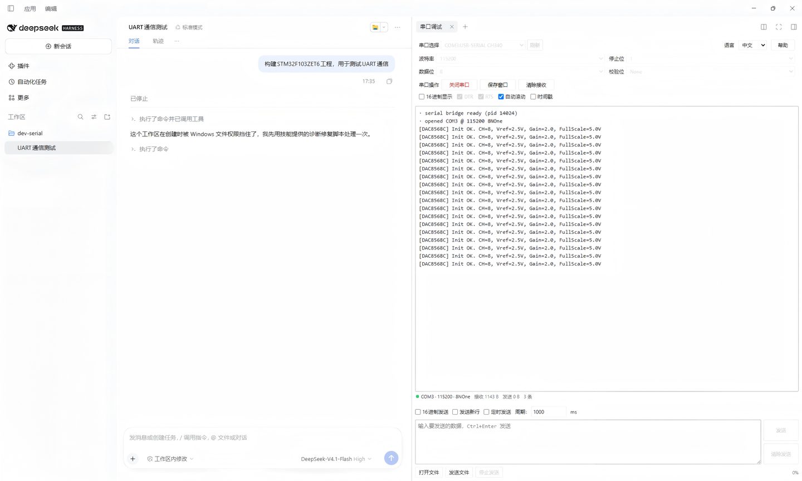

# dsh-serial-debugger

[中文](README.md) ｜ **English**

A serial-port debugger plugin for DeepSeek Harness. It puts a complete serial monitor/debug panel inside the DeepSeek Harness interface: **port parameter setup**, **live receive display**, and **data sending**.

- npm package: `dsh-serial-debugger`
- Repository: <https://github.com/floydc-sz/dsh-serial-debugger>
- Platform: **Windows / Linux** (Ubuntu 20.04 and later)

---

## Interface

The plugin lives in the **right sidebar of the DeepSeek Harness main window**, as a native tab.

1. Click **「打开侧边栏/Open sidebar」** in the title bar to open the right sidebar;
2. The right sidebar's guide page (its empty state) lists the tab types you can open, and one row is **「串口调试/Serial debugger」**;
3. Click that row and the serial debugger opens in the right column (the tab is labelled 「串口调试/Serial debugger」).



| Interface area | Functions |
| --- | --- |
| Parameters · first row | The **「串口选择/Port」** dropdown shows each device with its description (such as `COM3:USB-SERIAL CH340` on Windows systems, `/dev/ttyUSB0:FTDI` on Linux systems), and **「刷新/Refresh」** re-enumerates; when nothing enumerates it falls back to a free-text field. The right end of the same row holds **「语言/Language」** and **「帮助/Help」**. |
| Parameters · values | **「波特率/Baud rate」**, **「停止位/Stop bits」**, **「数据位/Data bits」** and **「校验位/Parity」**. |
| Parameters · actions | **「串口操作/Port action」** opens or closes the port and locks the parameters while connected; **「保存窗口/Save window」** exports the receive area to .txt; **「清除接收/Clear receive」** empties it. |
| Parameters · switches | **「16进制显示/Hex display」**, **「DTR」**, **「RTS」**, **「自动滚动/Auto-scroll」**, **「时间戳/Timestamps」**. |
| Receive area | Only newlines in the data break lines; a status line at the bottom shows the connection, the current parameters, the send/receive byte counts and the line count. |
| Send area · input | `Ctrl+Enter` sends, and **「发送/Send」** / **「清除发送/Clear send」** sit on the right. |
| Send area · switches | **Above** the input: **「16进制发送/Hex send」** (accepts `AA 55 01` and `0xAA,0x55`), **「发送新行/Append newline」**, **「定时发送/Timed send」** and its **「周期/Period」** in milliseconds. |
| Send area · files | **「打开文件/Open file」**, **「发送文件/Send file」** and **「停止发送/Stop sending」**, with the transfer progress bar and percentage on the right. |
| Help | Opens the feature help; close it with 「关闭/Close」. |
| Language | The **「语言/Language」** dropdown picks this plugin's Chinese or English interface; with no choice made it follows DeepSeek Harness's own language. |

Colors and fonts come from DeepSeek Harness theme tokens, so the panel follows the host's light and dark themes.

## Installation

```powershell
dsh plugin --profile desktop add dsh-serial-debugger
```

You can also install from a local directory (`<path-to-this-package>` is this repository checked out on disk):

```powershell
dsh plugin --profile desktop add <path-to-this-package>
```

After installing, restart DeepSeek Harness or let Hot Module Replacement apply, then open the panel as described under **Interface** above.

### Requirements

- **Windows.** The serial bridge uses .NET's `System.IO.Ports`, provided by the **Windows PowerShell 5.1** that ships with Windows, so there is nothing extra to install.

- **Linux (Ubuntu 20.04+).** There is no `System.IO.Ports` in the box, so the bridge drives the [`serialport`](https://www.npmjs.com/package/serialport) native binding. Install it once:

  ```bash
  dsh plugin --profile <your profile> add serialport
  ```

  If pnpm reports `ERR_PNPM_IGNORED_BUILDS`, allow the build script of `@serialport/bindings-cpp` and reinstall — DeepSeek Harness's notice offers exactly that.

- **Prebuilt or compiled.** `serialport` ships prebuilt binaries; where none exists it compiles locally and needs `build-essential` and `python3`.

- **Custom binding.** `DSH_SERIAL_MODULE` can point at another implementation of the same `SerialPort` surface, for offline deployments or a replacement.

- **Serial permissions.** A regular user cannot open `/dev/ttyUSB*` or `/dev/ttyACM*` by default. Add yourself to the serial group and **log back in**:

  ```bash
  sudo usermod -aG dialout $USER    # Ubuntu / Debian / Fedora
  sudo usermod -aG uucp    $USER    # Arch
  ```

  Without that, opening the port reports a clear message.

- **DSH `>= 0.2.0-rc.1`** (see `dsh.engines.dsh` in `package.json`).

## Release Notes

### 1.1.5 · 2026-11-13

- The interface section gained a screenshot, so the panel in the right sidebar can be seen without installing it
- The minimum DeepSeek Harness version is now 0.2.0-rc.1 and everything after it, where the declaration previously stopped at the 0.2.x line
- The requirements line uses the DSH abbreviation; the rest of the text keeps the full name

### 1.1.3 · 2026-11-11

- Documentation only: the interface table was rewritten to match the current panel, and the help, language, send-area and requirements notes were brought in line with the implementation
- Documentation only: abbreviations are spelled out — DSH is written as DeepSeek Harness, HMR as Hot Module Replacement

### 1.1.2 · 2026-11-11

- Fixed: one received message no longer splits across several lines, and Chinese text no longer turns into garbage
- With timestamps on, every line carries its own arrival time
- Both text areas are easier to read: larger type, clearer borders, a taller send box
- Send area reorganised: the send-mode switches moved above the input, and the file buttons share a line with the progress bar
- Parameters reorganised: the language switch joined the port row, Help moved to its right, control widths unified
- Help is now an overlay table with one entry per control, in on-screen order

### 1.1.1 · 2026-11-11

- Fixed: the plugin could not be updated on Windows (the new native-module dependency was blocked by the installer)
- Linux users install the serial library separately; see Requirements

### 1.1.0 · 2026-11-11

- Added Linux support (Ubuntu 20.04 and later); Windows usage and behaviour are unchanged

### 1.0.4 · 2026-11-10

- The language switch joined the port row, making the panel more compact

### 1.0.3 · 2026-11-10

- Added the interface language switch (中文 / English); the choice is remembered

### 1.0.2 · 2026-11-10

- Added an English README, `README-EN.md`

### 1.0.1 · 2026-11-10

- Corrected the requirements: the serial bridge is provided by the Windows PowerShell 5.1 that ships with Windows

### 1.0.0 · 2026-11-10

- First release: port parameters, live receive display, and data sending

## License

MIT, see [LICENSE](LICENSE).
